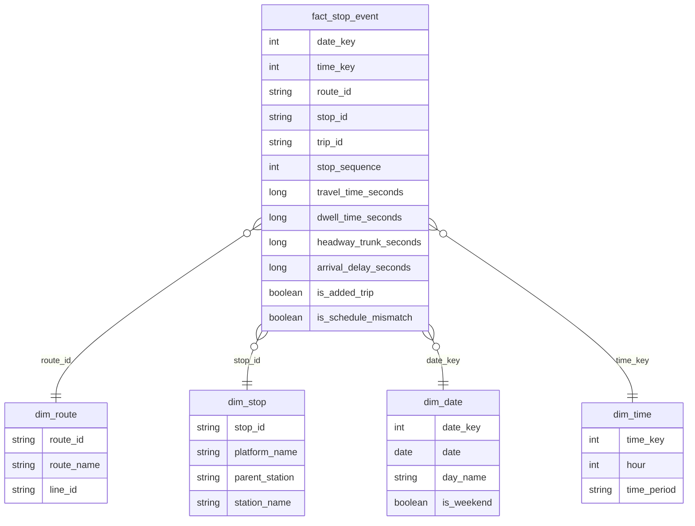
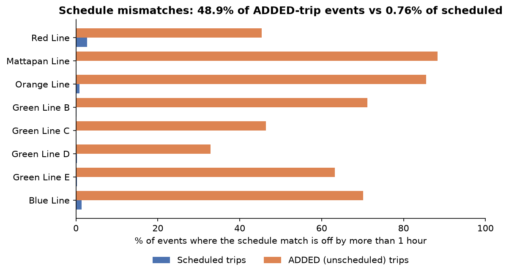
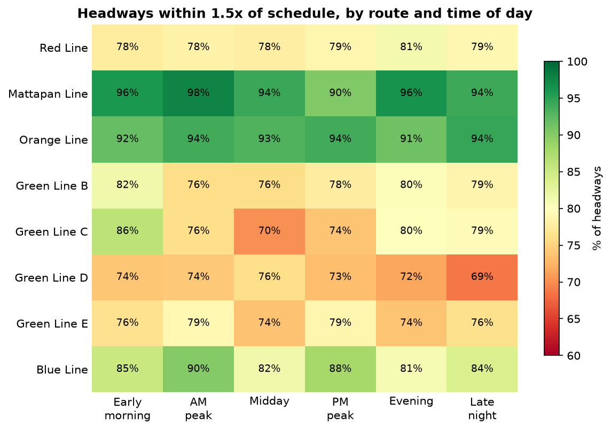
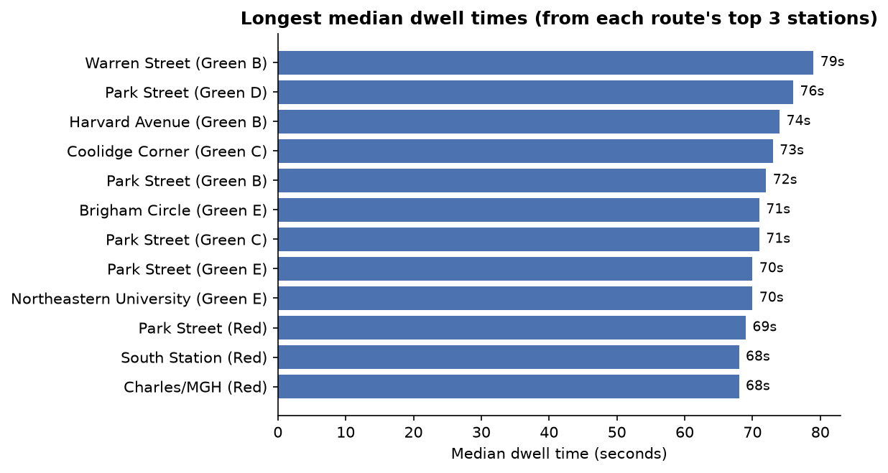
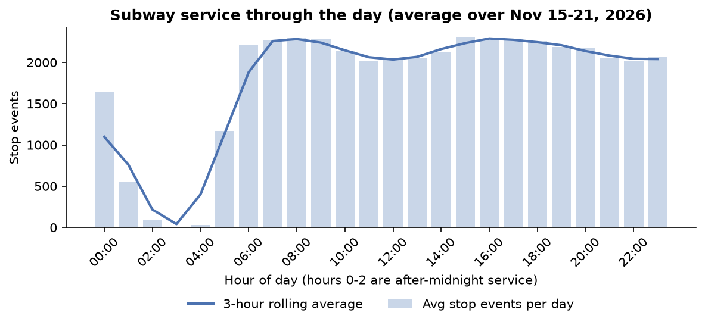

# MBTA Subway Operations Analytics

An ETL pipeline and star schema built on real MBTA subway performance data, implemented twice — once in PySpark and once in pandas — with a check that both produce identical results.

The analysis covers one week of service (Sunday Nov 15 – Saturday Nov 21, 2026): **297,904 stop events** across all 8 subway routes and 271 platforms.

## Data

All data comes from the MBTA's public [LAMP](https://performancedata.mbta.com/) feed (Lightweight Application for Measuring Performance):

- **Subway performance events** — one Parquet file per service day. Each row is one train arriving at one stop on one trip, with travel time, dwell time, headways and scheduled comparisons.
- **Static GTFS tables** — routes and stops. These keep a copy of every row for every GTFS version since 2019, so the stops table alone is 7.6M rows.

Raw data isn't committed to this repo. `01_download_data.py` pulls it fresh. Use of the data falls under the MassDOT Developers License Agreement.

## Pipeline

```
01_download_data.py    download the most recent N completed service days + static tables
02_profile_data.py     profile schema, row counts, nulls and categorical values
03_etl_spark.py        PySpark ETL -> star schema + data quality summary
04_run_queries.py      run everything in sql/ and save results as CSV
05_etl_pandas.py       same ETL in pandas
06_compare_etl.py      run both ETLs, time them, and check outputs match
07_make_charts.py      turn the query results into the charts in docs/images/
```

Profiling came first so the schema was designed around the real columns rather than guessed ones.

## Star schema



**Grain:** one train at one stop on one trip. The fact table is partitioned by `date_key`. (The diagram shows the main columns; the fact table has 25.)

A few design decisions:

- `date_key` comes from the **service date**, not the event timestamp. A train at 12:30 AM belongs to the previous day's service.
- `dim_time` has one row per minute of the day, tagged with a time period (am_peak, midday, etc.). The period boundaries are my own definitions, listed in `03_etl_spark.py`.
- The stops table is cut down with a broadcast semi-join to just the platforms and stations that appear in the events *before* picking the latest GTFS version with a window function, instead of running the window over all 7.6M rows.
- Direction and branch stay in the fact table as degenerate dimensions rather than separate tables.
- Occupancy data is left out on purpose: it's stored per railcar as pipe-delimited strings, and the percentage field is 78% null.

## Data quality

Rules run in two tiers:

- **Hard rules** reject the whole row into `rejected_events` with a reason: missing keys, missing timestamps, conflicting event keys, and routes or stops not found in the dimensions.
- **Soft rules** keep the row but null out implausible values: travel time over 30 min, negative dwell, headways over 2 hours, and arrival delays more than 1 hour off schedule.

Results for the week:

| Check | Result |
|---|---|
| Records passing validation | 99.89% (297,566 of 297,904) |
| Rejected | 338 conflicting event keys; no missing keys, timestamps or orphaned routes/stops |
| Implausible values nulled | 300 travel, dwell and headway readings |
| Arrival delays nulled | 25,172 (see below) |

Many nulls in the raw data are structural, not missing: lines without branches have no `branch_route_id`, and the first stop of a trip has no travel time.

### What the investigations found

**The rejected "duplicates" weren't duplicates.** The 338 rows share a `(service_date, trip_id, stop_sequence)` key with another row, but only 33 have the same arrival time and 100 are at a different stop. That key isn't always unique in LAMP, so these are tagged `conflicting_event_key` rather than treated as copies.

**Schedule comparisons break down for unscheduled trips.** Trips with an `ADDED-` ID aren't in the published schedule. They make up 16% of events but **92.5% of the schedule mismatches** — a 48.9% mismatch rate, versus 0.76% for scheduled trips. Because of this, headway adherence is used as the main reliability metric instead of schedule delay.



**Headway adherence holds up with or without ADDED trips.** Excluding them changes adherence by at most 0.6 percentage points on any route, and Green Line D remains the lowest (73.6%). Most ADDED events lack a headway or scheduled headway value and drop out of the metric, so unlike schedule delay, headways aren't distorted by them.

**Headways reproduce independently.** Recomputing trunk headways from arrival timestamps with `LAG` matches LAMP's own `headway_trunk_seconds` within 2 minutes for **91.8% of 260,127 headways** (median difference: 8 seconds). The small offset suggests LAMP measures headways on a slightly different timestamp.

## Analysis

The queries in `sql/` use window functions (`LAG`, `DENSE_RANK`, rolling `AVG OVER`), CTEs and multi-table joins. Some results:



- **Headway adherence** (share of headways at most 1.5x scheduled): Orange Line 91–94% across time periods and Mattapan 90–98%, while Green Line D is the weakest in every period at 69–76%. Blue ranges 81–90%, Red 78–81%.
- **Longest dwell times:** Park Street ranks in the top 3 on the Red Line and Green Line B, C, D and E branches. Warren Street on the B branch has the longest median dwell of any station (79 s).
- **Weekday vs weekend:** average segment travel and dwell times differ by less than 7 seconds on every route.





## Spark vs pandas

Both implementations apply the same rules. `06_compare_etl.py` runs each three times and compares the outputs.

| | Median end-to-end runtime |
|---|---|
| pandas | 1.8 s |
| PySpark (local mode) | 20.5 s |

The data quality summaries match exactly, and all 392 day/route/measure aggregates in the fact tables are identical.

At 300K rows pandas is about 11x faster, since Spark's JVM startup and job planning dominate at this size. The Spark version exists for scale: it runs unchanged on much larger date ranges, or on a cluster (EMR, Glue) by changing the master and paths, and the parity check means the engines can be swapped without the numbers changing.

## Known limitations

- **Trip counts aren't reliable on some routes.** `COUNT(DISTINCT trip_id)` gives odd results where ADDED trips are common — e.g. Green Line D shows 2,098 "trips" on Sunday with only ~2 stop events each, and Green Line C shows 6. Stop events and headways are better measures of service here.
- **Terminal segments dominate the slowest-segment ranking** (Ashmont, Braintree, Oak Grove, Riverside), and several have a scheduled time of exactly 60 s. That may reflect terminal layover or a placeholder schedule value, so those results need checking before being read as slow track.
- **One week of data.** Findings describe this week only.
- **Time period boundaries and headway thresholds** are project definitions, not official MBTA ones.

## Running it

Requires Python 3.10–3.12 and Java 17 (for Spark).

```
pip install -r requirements.txt
python 01_download_data.py            # --days N for a different window
python 02_profile_data.py > profile_output.txt
python 03_etl_spark.py
python 04_run_queries.py
python 06_compare_etl.py              # also runs 05_etl_pandas.py
python 07_make_charts.py
```

Outputs go to `data/warehouse/` (Spark), `data/warehouse_pandas/` (pandas), `data/results/` (query CSVs) and `docs/images/` (charts, committed so they show here).

## Next steps

- Run the comparison on 30 and 90 days to find where Spark overtakes pandas
- Add an interactive dashboard on top of the results tables
- Track headway adherence over multiple weeks